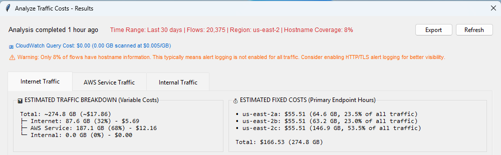
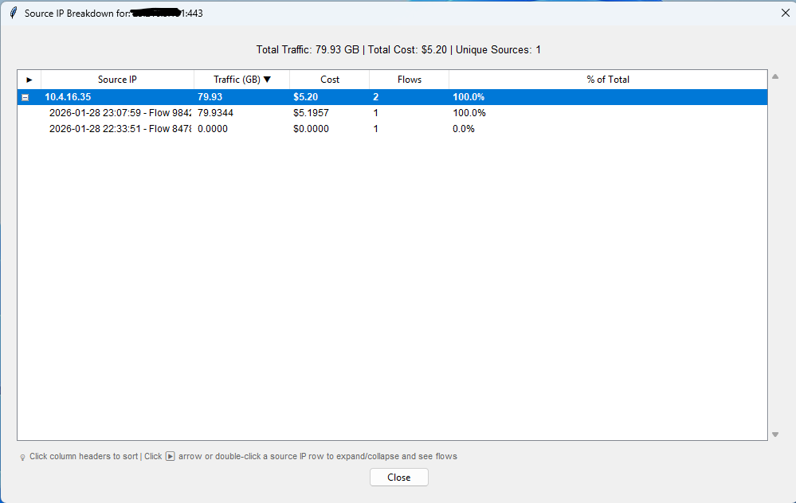

# Analyze Traffic Costs - Full Reference

> Part of the **Suricata Rule Generator for AWS Network Firewall**. This is the complete reference for the Analyze Traffic Costs feature. For the overview and quick-start steps, see the [Analyze Traffic Costs section in the README](../README.md#analyze-traffic-costs-new-in-v1290-enhanced-in-v2141).

The Traffic Cost Analyzer correlates AWS Network Firewall CloudWatch Logs to show exactly where bandwidth is going and which AWS services could benefit from VPC endpoints.

## Intelligent VPC Endpoint Recommendations

**Gateway Endpoints (Always FREE):**
- S3 and DynamoDB gateway endpoints cost $0
- Always recommended when same-region traffic detected
- Eliminate firewall data processing charges completely
- Example: 245 GB/month to S3 -> Save $15.93/month ($191/year)

**Interface Endpoints (Cost-Benefit Analysis):**
- Break-even threshold: 112 GB/month for same-region (us-east-1: $7.30/month endpoint cost / $0.065/GB)
- Only recommended when traffic exceeds break-even
- Example: 85 GB/month to SSM -> Skip (not cost-effective)
- Example: 180 GB/month to Lambda -> Deploy (saves $4.40/month)

**Regional Pricing:**
- Accurate cost calculations using regional firewall data processing and endpoint-hour rates
- Interface endpoint costs vary by region
- Break-even thresholds adjusted per region automatically
- CloudWatch Logs Insights query cost uses the region's rate ($0.005/GB in many regions, up to $0.009/GB in others)
- Prices were checked against current AWS pricing for every supported region in November 2026

**Cross-Region Guidance:**
- Identifies cross-region AWS service traffic
- Suggests alternatives (S3 CRR, DynamoDB Global Tables)
- Interface endpoint support varies by service

## CloudWatch Logs Integration

**Correlation Engine:**
- Combines FLOW logs (traffic volumes) with ALERT logs (hostnames/SNI)
- Correlates via flow_id for complete traffic picture
- Collects the hostname of every flow that has one, across the whole time range
- Flows with no hostname of their own are shown under a hostname when their destination IP was seen with that hostname; if an IP was seen with several hostnames, the one with the most traffic is used
- The header's Hostname Coverage is the share of Internet traffic (by bytes) shown under a hostname
- Handles millions of log entries efficiently

**Large Time Ranges:**
- CloudWatch Logs Insights returns at most 10,000 rows per query, so the analysis aggregates on the server and splits the time range into chunks, sized from where the log records actually are (empty stretches are skipped)
- Chunks run in parallel; a chunk that still reaches the row limit is split again, so no data is dropped
- Throttled requests are retried automatically, and the progress dialog shows how many were retried
- The progress dialog shows the current step (for example "Step 2 of 5") and one overall progress bar; Cancel or closing the dialog stops the analysis
- The analysis and Save run in the background, so the app stays responsive

**AWS Service Detection:**
- Downloads AWS IP ranges for service identification
- Interval tree for O(log n) lookups (100,000x faster than naive approach)
- Identifies S3, DynamoDB, Lambda, EC2, CloudFront, and 20+ other services
- AWS publishes overlapping IP ranges (every range is also listed under a general "AMAZON" entry, and S3 ranges are also listed under EC2); the most specific service is used, so CloudFront and EC2 traffic is not mislabeled as S3
- When a flow has a hostname, the service and region come from it (for example `logs.us-east-2.amazonaws.com` is CloudWatch Logs in us-east-2). ECR's API and image-layer hostnames are shown as separate services because each needs its own endpoint, and S3 dual-stack and FIPS hostnames get the correct region
- Traffic that no VPC endpoint can serve, such as CloudFront, stays on the AWS Service Traffic tab and is marked "SKIP - No VPC endpoint available"

## Data Caching

**Save Results:**
- Save analysis results to .stats file (same format as Rule Usage stats)
- Unified v2.0 format supports both Rule Usage and Traffic Analysis data
- Saved files hold the three tabs and the per-source-IP drill-down tables, not individual flows, so they stay small (a 16-day analysis of a busy firewall is about 0.2 MB)
- Avoid CloudWatch Logs query charges on repeat views
- Files saved by earlier versions still open, and are written in the current format the next time you save

**Auto-Load:**
- Cached data detected when rule file is opened
- Prompt to load cached (instant) or run fresh analysis
- Shows data age for informed decision

**Instant Drill-Down:**
- Cached data supports all three main tabs and every drill-down

## Source IP Drill-Down

**Double Click Any Row:**
- See source IP breakdown showing which internal hosts generate traffic
- Each source shows its traffic (GB), cost, flow count, and % of the row's total
- Sort by any column (source IP, traffic volume, cost, flow count, % of total)
- Right-click selected rows to copy them (tab-separated, with a header line) for pasting into a spreadsheet

## Custom Date Ranges

**Flexible Time Periods:**
- Preset ranges: 7, 15, 30, 60, 90 days
- Custom date range picker
- Analysis metadata shows exact date range used

## Benefits

**Cost Optimization:**
- Potential VPC endpoint savings: $50-200/month
- Gateway endpoints (FREE) eliminate costs for S3/DynamoDB traffic
- Interface endpoints only recommended when ROI is positive
- Regional pricing ensures accurate projections

**Traffic Visibility:**
- See exactly where bandwidth is going
- HTTP/TLS hostname resolution shows application-level detail (when available)
- Multiple destination IPs per hostname consolidated (CDN load balancing)
- Source IP drill-down shows which hosts consume bandwidth

**Smart Recommendations:**
- Break-even analysis prevents wasteful endpoint deployments
- Alternative suggestions for sub-threshold traffic
- Regional considerations for cross-region traffic
- Data-driven decisions backed by actual traffic analysis

**Easy to Use:**
- Works with existing CloudWatch logs
- No additional AWS configuration needed
- Caching reduces CloudWatch charges
- CSV export for offline analysis and reporting

## Use Cases

**Monthly Cost Review:**
- Identify new VPC endpoint opportunities
- Track traffic pattern changes
- Verify existing endpoints still cost-effective
- Report savings to management

**Architecture Optimization:**
- Discover cross-region traffic patterns
- Identify candidates for S3 Cross-Region Replication
- Find opportunities for DynamoDB Global Tables
- Optimize service placement decisions

**Troubleshooting High Bills:**
- See which destinations consume most bandwidth
- Identify unexpected traffic patterns
- Correlate costs with specific applications
- Drill down to source IPs for accountability

> **ROI**: Analysis costs $0.50-$2.00 but identifies $50-200/month in potential savings. The query cost is recovered quickly.
